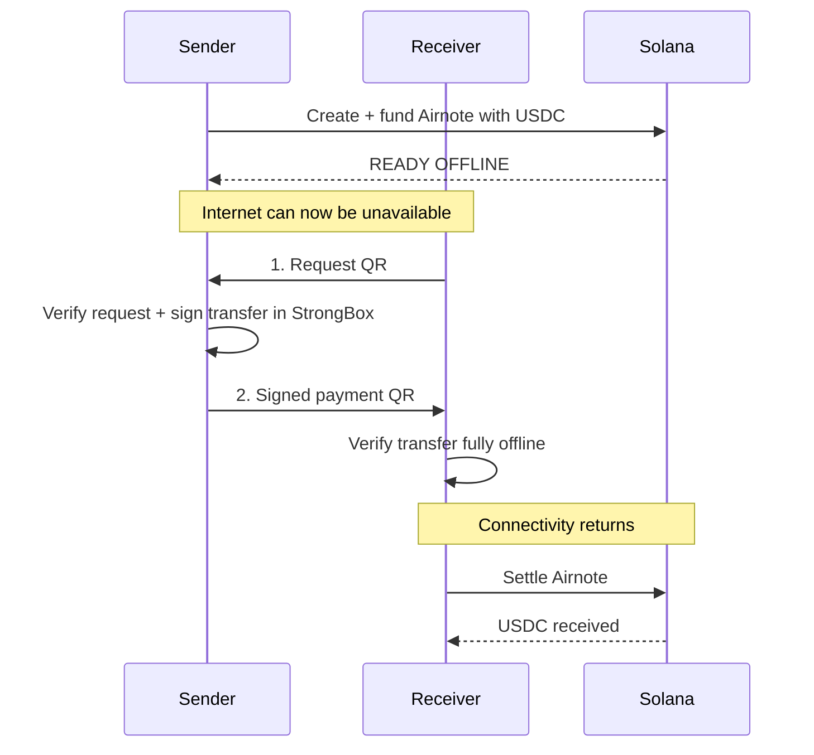

# AIRNOTE

**Money that moves with you.**

AIRNOTE is an offline-first USDC payment app built for **Solana Mobile** and **Seeker**.

Prepare a pre-funded Airnote while connected, transfer it device-to-device with **two QR scans while completely offline**, then settle it on Solana when connectivity returns.

> **Prepare online. Pay offline. Settle on Solana.**

AIRNOTE lets you turn part of your USDC balance into a **pre-funded mobile payment note** before you lose connectivity. That note can then be handed to another person **without internet access** using a two-QR exchange between phones. The receiver verifies the payment locally, keeps the signed Airnote on their device, and settles it for USDC on Solana once connectivity returns.

In practice, AIRNOTE is useful anywhere mobile data is unreliable or unavailable: events, travel, crowded venues, remote areas, temporary outages, or any situation where both people still have their phones but the network cannot be trusted.

**Android APK:** GitHub Release build coming from the latest successful CI artifact  
**Seeker Store:** Soon

---

## What AIRNOTE does

AIRNOTE turns online liquidity into an offline-capable payment credential.

A sender first funds an Airnote with a fixed amount of USDC while online. Once the Airnote reaches **READY OFFLINE**, the underlying funds are already secured on Solana, so the sender no longer needs a live RPC connection during the handoff.

When paying someone offline:

- the receiver creates a payment request on their phone;
- the sender scans that request and authorizes the transfer with a hardware-backed key on Seeker;
- the sender shows a signed payment QR;
- the receiver scans and verifies it entirely offline.

The receiver now holds the signed right to settle that Airnote. When either device regains connectivity, the receiver can submit it on-chain and receive the USDC.

This means AIRNOTE is **not** an offline wallet that spends arbitrary funds. It is a system for preparing specific value online, moving the right to claim that value offline, and settling it safely later.

---

## Why AIRNOTE

Mobile payments usually fail at the exact moment connectivity disappears.

AIRNOTE changes the payment flow by moving blockchain interaction to the edges:

1. **Prepare online** — fund a single-use Airnote with USDC on Solana.
2. **Pay offline** — sender and receiver exchange a signed payment using two QR scans.
3. **Settle online** — when connectivity returns, the receiver settles the Airnote on Solana.

The offline handoff does **not** spend arbitrary wallet funds. Each Airnote is pre-funded before going offline.

---

## The 2-scan offline payment flow



The protocol intentionally remains a **two-scan flow**:

- **Scan 1:** receiver creates a request bound to their wallet, a nonce and an expiry.
- **Scan 2:** sender signs the Airnote transfer and shows the signed payment QR back to the receiver.

No network connection is required during those two scans.

---

## Built for Seeker

AIRNOTE is not a web app wrapped for mobile. The core payment system was developed around native Android and Solana Mobile capabilities.

### Hardware-backed signing

AIRNOTE generates and uses a **P-256 signing key inside Android StrongBox** on Seeker.

The private key remains non-exportable and is used to authorize offline handoffs directly on-device.

### Native mobile payment UX

- Solana **Mobile Wallet Adapter** for funding and settlement
- native Android QR camera flows
- offline request and payment verification
- locally persisted Airnote state
- connectivity recovery and settlement UX
- expired unsent Airnote refund flow

---

## SKR Reserve+

AIRNOTE includes an **SKR-powered Reserve+ tier**.

The app performs a read-only check of the connected wallet's liquid SKR balance on **Solana Mainnet**.

A verified SKR holder unlocks:

| Tier | Maximum Airnote | Offline lifetime |
| --- | ---: | ---: |
| Standard | 5 USDC | 6 hours |
| **SKR Reserve+** | **10 USDC** | **24 hours** |

SKR is used as an **access credential**. AIRNOTE does not transfer or lock the user's SKR.

AIRNOTE payment funding and settlement currently remain on **Solana Devnet**.

---

## Security model

AIRNOTE uses pre-funded, single-use payment credentials rather than attempting to make an arbitrary wallet balance spendable offline.

This gives the protocol a clear security boundary:

- funds are locked on Solana before an Airnote becomes usable offline;
- the offline transfer is cryptographically signed on the sender device;
- the receiver can verify the payment without connectivity;
- settlement happens on-chain after connectivity returns;
- an expired Airnote that was **never handed off** can be refunded by the original funder;
- handoff-authorized notes are not treated as safely refundable because a receiver may already possess the signed payment.

---

## Current implementation

AIRNOTE has completed a physical end-to-end flow on a real Seeker:

**Create & Fund → READY OFFLINE → disable connectivity → receiver request QR → sender scan → signed payment QR → receiver offline verification → restore connectivity → settle → SETTLED**

### Solana

- **Network:** Solana Devnet
- **Program:** `DyT3zjATxr4Fg28Ne3DjjV5Q6rd6JWx2Vo7agZZxZFx9`
- **USDC mint:** `4zMMC9srt5Ri5X14GAgXhaHii3GnPAEERYPJgZJDncDU`

### Attestation service

- **Endpoint:** `https://api.airnote.cash/certify`
- AIRNOTE certificates bind the funded note to the mobile signing identity used by the offline protocol.

---

## Protocol

AIRNOTE currently uses two compact QR wire formats:

```text
airnote:r1:   receiver request
airnote:t1:   signed offline transfer
```

The signed transfer payload is designed to fit reliably inside a QR code while carrying the information required for offline verification.

For protocol details, see:

- [Gate 01 — Protocol](docs/gate-01-protocol.md)
- [Gate 10 — Two-scan UX](docs/gate-10-two-scan-ux.md)
- [Gate 13 — Wallet binding / offline ready](docs/gate-13-wallet-binding-offline-ready.md)
- [Gate 15 — SKR Reserve+](docs/gate-15-skr-reserve-plus.md)

---

## Build

### Requirements

- JDK 17
- Android SDK 35
- Gradle 8.x
- Android device or Solana Seeker

From the repository root:

```bash
gradle test
gradle :app:assembleDebug
```

The APK is produced at:

```text
app/build/outputs/apk/debug/app-debug.apk
```

Install it with ADB:

```bash
adb install -r app/build/outputs/apk/debug/app-debug.apk
```

For the intended experience, test AIRNOTE on a physical **Solana Seeker**.

---

## Project status

AIRNOTE is currently a working hackathon beta.

- ✅ Native Android application
- ✅ Physical Seeker end-to-end flow
- ✅ StrongBox P-256 signing
- ✅ Two-scan offline transfer
- ✅ Offline receiver verification
- ✅ Solana USDC funding + settlement
- ✅ Expired unsent Airnote refunds
- ✅ SKR Reserve+
- ✅ Activity / payment detail UX
- ✅ Devnet testing shortcuts
- 🚧 Production hardening
- 🔜 Seeker Store

---

## Product thesis

AIRNOTE does not try to make Solana itself work without the internet.

It prepares value **before** connectivity disappears, moves proof of ownership **locally** while offline, and uses Solana again when the network returns.

**Money that moves with you. Online or off.**
